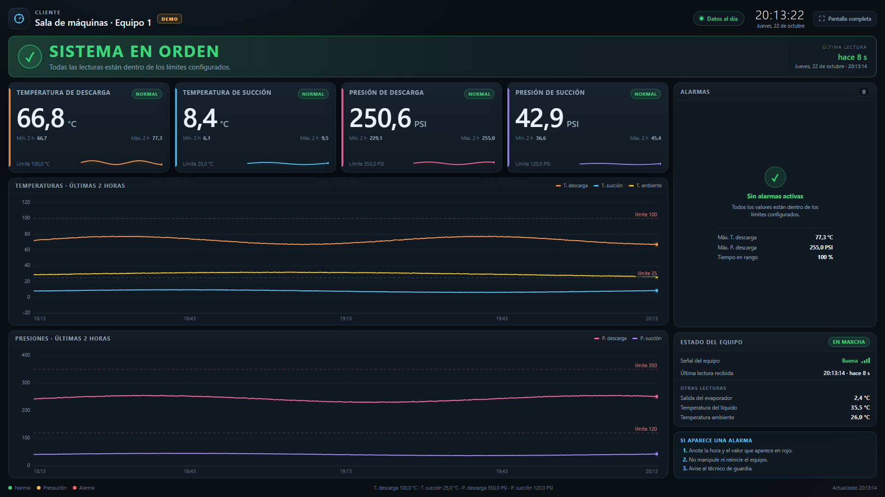

# Panel de supervisión para sala de vigilancia

Dashboard independiente pensado para que una persona **sin conocimientos técnicos**
vigile la planta desde un monitor fijo. No es un panel de diagnóstico: muestra solo
lo necesario para decidir si todo está bien o si hay que llamar al técnico.

Los datos se leen en vivo de Supabase, de la misma tabla `lecturas_hvac` que ya
escribe el ESP32 cada 10 segundos.



*Aspecto del panel en modo demostración, a 1920 × 1080.*

## Qué muestra

| Zona | Contenido |
|---|---|
| Cabecera | Cliente, planta, hora local, estado **Conectado / Falla / Error** con la calidad de la señal y botón de pantalla completa |
| Franja de estado | Un solo mensaje grande: **Sistema en orden**, **Requiere atención**, **Alarma activa**, **Falla · sin datos** o **Equipo en reposo** |
| Tarjetas grandes | Temperatura de descarga, temperatura de succión, presión de descarga, presión de succión, salida del evaporador, temperatura del líquido y temperatura ambiente, con valor actual, mínimo/máximo de las últimas 2 h y mini-tendencia |
| Historial | Tabla con todas las variables, modo **En vivo / Histórico**, filtro por fecha y hora, paginación y estado del equipo en cada lectura |
| Alarmas | Lista en lenguaje sencillo con el valor, el límite y qué hacer |
| Ayuda | Instrucción permanente: anotar, no manipular y avisar |

El estado **Equipo en reposo** se deduce de la diferencia entre la presión de
descarga y la de succión, pero ese cálculo no se muestra: al operador solo le
interesa saber si el equipo está trabajando, no el número técnico. Ese estado solo
se muestra cuando los datos están frescos; si el ESP32 deja de enviar, la franja
cambia a **Falla · sin datos** y no se inventa un estado de marcha.

Si las presiones llevan más de **30 min** igualadas aparece un aviso; a los
**45 min** se considera **FALLA**. También se avisa si la presión de succión
completa **3 ciclos en una hora**: baja a ≤ 30 PSI, sube a ≥ 55 PSI y vuelve
a bajar, con una duración total de **30 segundos a 5 minutos** por ciclo. Ese
patrón (por ejemplo, 60 → 25 → 60 PSI) puede indicar una fuga, una falla del
solenoide o un presostato mal regulado.

### Criterios de color

- **Verde:** todo dentro de rango.
- **Ámbar:** un valor se acerca al límite, las lecturas están atrasadas o hay un
  problema momentáneo de conexión.
- **Rojo:** un valor superó el límite, el equipo dejó de enviar datos o las
  presiones llevan 45 min igualadas.
- **Gris azulado:** el equipo está en reposo normal (presiones igualadas hace menos de 30 min).

El estado se calcula con los límites de `js/config.js`:

| Canal | Precaución | Alarma |
|---|---:|---:|
| Temperatura de descarga | 90 °C | 100 °C |
| Temperatura de succión | 22 °C | 25 °C |
| Presión de descarga | 320 PSI | 350 PSI |
| Presión de succión | 110 PSI | 120 PSI |

## Historial de lecturas

La tabla funciona como un pequeño **sumario** del equipo: muestra todas las
variables de `lecturas_hvac` y el estado (**Marcha / Reposo**) de cada lectura.

- Se puede escribir un rango **Desde / Hasta** o usar los botones **2 h**, **24 h**
  y **7 días**.
- El rango inicial es de las últimas **24 horas**; se cambia con
  `historial.horasPorDefecto` en `js/config.js`.
- Cuando el rango termina en el presente, el indicador dice **En vivo** y la tabla
  se actualiza sola cada **30 s** en la primera página, mientras el operador esté
  al inicio de la tabla.
- Si el operador pasa a una página anterior o consulta un rango pasado, el
  indicador cambia a **Histórico** y la tabla queda fija para que pueda leer sin
  que los datos se muevan. Al pulsar **24 h** vuelve al presente.
- Si no hay lecturas en el rango, muestra la última lectura recibida y un botón
  **Ver últimas 24 h**.
- La tabla trae **100 filas por página** y permite avanzar y retroceder. El total
  se calcula con Supabase, así que un rango de varios días sigue siendo consultable.
- Las fechas se muestran en la zona horaria de `zonaHoraria` (`America/Caracas`).
- El botón **Consultar** sigue disponible para aplicar un rango manual.
- En pantallas de poca altura (portátiles de 768 px o navegador con zoom) el
  panel se compacta automáticamente para que la tabla muestre varias filas. Si
  aun así no cabe, el panel completo se puede desplazar; la tabla nunca queda
  aplastada hasta desaparecer.

## Archivos

```
supervision/
├── index.html          estructura de la pantalla
├── css/estilos.css     diseño oscuro y adaptabilidad
├── js/config.js        TODO lo configurable (cliente, Supabase, límites)
├── js/app.js           lectura de datos, alarmas e historial
├── docs/estados.png    captura de referencia
└── README.md
```

No hay dependencias, ni compilación, ni `npm install`. Es HTML, CSS y JavaScript
sin frameworks, y funciona sin conexión a Internet salvo para consultar Supabase.

## Puesta en marcha

1. Edite `js/config.js`:
   - `cliente` y `planta`: textos de la cabecera.
   - `contacto.nombre` y `contacto.telefono`: a quién llamar.
   - `supabase.url`, `supabase.clave` y `supabase.tabla`.
   - Límites de cada canal (`aviso`, `max`, opcionalmente `min`).
   - `historial.porPagina`, `historial.horasPorDefecto` y `historial.autoMs`
     para la tabla.
2. Abra `index.html` en el navegador. Para evitar restricciones de archivos
   locales, se recomienda servirlo por HTTP:

   ```bash
   # Desde la carpeta que contiene a supervision/
   python -m http.server 8080
   # Abrir http://localhost:8080/supervision/
   ```

3. Compruebe que la franja diga **Sistema en orden** y que la hora de la última
   lectura sea reciente.

### Probar sin Supabase

- `index.html?demo=1`: datos simulados, útiles para ajustar la pantalla.
- `index.html?demo=1&aviso=1`: simula una lectura cerca del límite (ámbar).
- `index.html?demo=1&alarma=1`: simula una temperatura de descarga alta (rojo).

En modo demo aparece la etiqueta **DEMO** en la cabecera y el historial genera
datos simulados para el rango que se consulte.

## Supabase

La tabla esperada es la que ya usa el proyecto:

```sql
create table public.lecturas_hvac (
  id            bigint generated by default as identity primary key,
  created_at    timestamptz not null default now(),
  presion_baja  real,
  presion_alta  real,
  temp1         real,   -- succión
  temp2         real,   -- salida del evaporador
  temp3         real,   -- descarga
  temp4         real,   -- líquido
  temp5         real,   -- ambiente
  wifi          text,
  ip            text,
  rssi          integer
);
```

El panel solo necesita permiso de lectura. Con RLS activado:

```sql
alter table public.lecturas_hvac enable row level security;

create policy "lectura publica para el panel"
on public.lecturas_hvac
for select
to anon
using (true);
```

> **Seguridad:** la clave `anon` es pública por diseño y puede ir en el navegador.
> La protección real son las políticas RLS. **Nunca** coloque la clave
> `service_role` en este panel ni en ningún archivo que llegue al cliente.

### Si hay varios clientes

Cada cliente debe tener su propia copia de la carpeta y su propio `js/config.js`.
Si todos comparten la misma tabla, cree una vista por cliente o filtre por una
columna de planta; así un cliente nunca puede ver los datos de otro.

## Pantalla de vigilancia (kiosco)

Opciones recomendadas para el monitor fijo:

- Resolución 1920 × 1080 y escala de Windows al 100 %.
- Edge o Chrome en modo kiosco:

  ```bat
  "C:\Program Files (x86)\Microsoft\Edge\Application\msedge.exe" ^
    --kiosk "http://servidor/supervision/" ^
    --edge-kiosk-type=fullscreen ^
    --no-first-run ^
    --disable-pinch
  ```

- Desactivar el apagado de pantalla y la suspensión del equipo.
- Colocar el acceso directo en la carpeta de inicio de Windows.
- Las tarjetas, alarmas y el historial **En vivo** se actualizan solos: no hace
  falta recargar la página.
- El historial pasa a **Histórico** cuando se consulta una página o un rango
  pasado; al pulsar **24 h** vuelve al presente.
- La tecla `F` o el botón de la cabecera activan pantalla completa.

El panel está pensado para 16:9 y también se adapta a tabletas y teléfonos, aunque
en esos tamaños la información se apila y requiere desplazamiento.

## Cómo funciona la actualización

- Última lectura: cada **10 s**.
- Mínimos, máximos y mini-tendencias de las tarjetas: cada **60 s**.
- Edad de la lectura y reloj: cada **1 s**.
- Historial **En vivo**: cada **30 s** en la primera página.
- Historial **Histórico**: queda fijo hasta que se pulse **Consultar** o **24 h**.
- Si una consulta falla, conserva el último dato y reintenta automáticamente.
- A los **45 s** sin lectura nueva avisa; a los **3 min** declara **Falla · sin datos**.

Todos estos valores se cambian en `js/config.js` (`actualizacion`, `historial` y
`frescura`).

## Diagnóstico rápido

| Síntoma | Qué revisar |
|---|---|
| **Sin conexión** | Clave `anon`, URL del proyecto, nombre de la tabla y políticas RLS |
| **Falla · sin datos** | Energía o conexión del ESP32; última fila en Supabase |
| **No aparecen datos históricos** | RLS de `select`, que `created_at` esté en UTC y que el rango elegido tenga lecturas; pruebe **24 h** o **7 días** |
| **Las horas no coinciden** | `zonaHoraria` en `js/config.js` (por defecto `America/Caracas`) |
| **Todo sale gris** | Los nombres de columna no coinciden con `canales` en `js/config.js` |

Para verificar la conexión manualmente:

```text
https://SU-PROYECTO.supabase.co/rest/v1/lecturas_hvac?select=*&order=created_at.desc&limit=1&apikey=SU-CLAVE-ANON
```

## Ajustes habituales

- **Cambiar el nombre del cliente o la planta:** `cliente`, `planta`.
- **Cambiar un límite:** `aviso` y `max` del canal correspondiente.
- **Añadir otro canal a una tarjeta principal:** agregue el objeto al arreglo
  `canales` con `principal: true` y su `id` igual al nombre de la columna en Supabase.
- **Añadir una tarjeta compacta:** use `principal: false`, `tarjeta: true` y
  `compacta: true`; aparece en la segunda fila de tarjetas.
- **Añadir una columna al historial:** agregue el canal al arreglo `canales`;
  la tabla toma automáticamente todos los canales configurados.
- **Cambiar la ventana de las mini-tendencias:** `actualizacion.ventanaHoras`.
- **Cambiar filas por página, rango inicial o refresco del historial:**
  `historial.porPagina`, `historial.horasPorDefecto` y `historial.autoMs`.
- **Mostrar el teléfono del técnico:** `contacto.telefono`.

Si cambia la cantidad de tarjetas, revise la rejilla en `css/estilos.css`:
`.kpis` usa 12 columnas en escritorio, las principales ocupan 3 y las compactas 4.
En pantallas pequeñas se acomodan de a dos.
